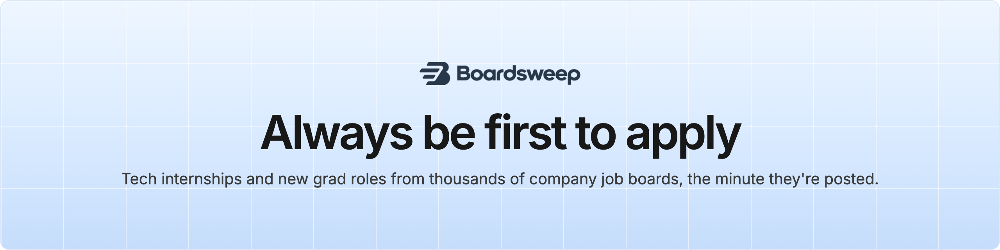

<a href="https://boardsweep.io/?utm_source=github&utm_medium=profile"><picture><source media="(prefers-color-scheme: dark)" srcset="assets/banner-dark.png"></picture></a>

**Boardsweep** reads company job boards directly, thousands of them every hour and the top 150 companies every 3 minutes, and emails students new internships and new grad roles the moment they're posted, while the applicant pile is still small.

### Free on GitHub

| | |
| --- | --- |
| 📚 **[Summer 2027 internships](https://github.com/Boardsweep/summer-2027-internships)** | Every open tech internship, by field, with pay where the posting lists it. Updated every day. |
| 🎓 **[2027 new grad roles](https://github.com/Boardsweep/new-grad-2027)** | New grad and entry-level tech roles, same format. |
| 🤖 **[Boardsweep for AI assistants](https://github.com/Boardsweep/mcp)** | Ask Claude, ChatGPT, Claude Code or Cursor for roles. Free MCP server, no sign-in. |

### Get them first

The lists here run a day behind. **[Get a free daily digest](https://boardsweep.io/?utm_source=github&utm_medium=profile&utm_content=digest)**, or **[get each role the minute it's posted](https://boardsweep.io/?utm_source=github&utm_medium=profile&utm_content=pass#pricing)** with the season pass (7 days free).

Questions or a role we missed? support@boardsweep.io · [boardsweep.io](https://boardsweep.io/?utm_source=github&utm_medium=profile)
